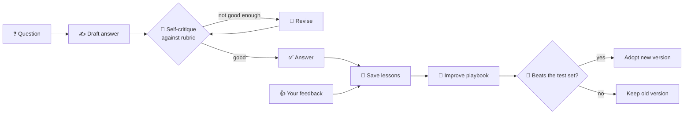

<div align="center">

# 🧠 SIA — Self-Improving Agent

**An AI assistant for any subject that gets better the more you use it.**

Give it your documents, a few example answers and some feedback.
It practises, critiques itself, writes down what it learned, and keeps a change only when a test shows it helps.


[What it is](#-what-is-this) · [How it learns](#-how-it-learns) · [Quickstart](#-quickstart-10-minutes) · [Demo results](#-real-demo-results) · [API](#-using-the-api) · [Deploy](#-deploy)

</div>

---

## 👋 What is this?

Most AI chatbots are the same on day 100 as on day 1. **SIA is different.** It's a small server that wraps
any large language model (LLM), such as Google Gemini, and gives it a way to **learn from experience**, a bit
like a new employee:

| A new employee... | SIA... |
|---|---|
| 📚 reads the company handbook | indexes the documents you upload |
| ✍️ drafts an answer, rereads it, fixes it | writes a draft, grades it against your rubric, revises |
| 📝 keeps notes on what worked | saves short **lessons** after every task |
| 🧑‍🏫 listens when a manager corrects them | turns your ratings and corrections into new lessons |
| 🔄 rethinks how they work every so often | rewrites its **playbook**, but only keeps it if a test proves it's better |

You can make an agent for **any domain**: tax questions, legal triage, customer support, sales, code review...

> [!NOTE]
> SIA never retrains the model itself. Everything it learns is plain text (lessons, a playbook, your
> documents) that you can read, edit, switch off or roll back. That's why it works with **any provider and any
> free tier**.

---

## 🔁 How it learns



It improves on five timescales:

| When | What happens | What it learns from |
|---|---|---|
| **During one answer** | Draft → self-critique → revise (keeps the best attempt) | An AI reviewer using your rubric |
| **Across answers** | Each task is boiled down into short lessons. Lessons used in good answers gain points; ones linked to bad answers are retired automatically. | Critique scores, user ratings |
| **From people** | Ratings re-score the lessons that were used; corrections become new lessons **and** new test examples. | Human feedback |
| **Self-study** | It quizzes itself on your documents and grades itself against the source. | Your documents |
| **Consolidation** | `improve` rewrites the playbook (its strategy prompt) and adopts it **only if it scores higher on the test set**. Every version is kept, so you can roll back. | Your test examples |

---

## 🚀 Quickstart (10 minutes)

### What you need

- **Python 3.12** ([download](https://www.python.org/downloads/))
- **A free Gemini API key**: sign in at [Google AI Studio](https://aistudio.google.com/apikey) and click
  *Create API key*. No credit card needed.

### 1. Get the code

```bash
git clone https://github.com/SrijithLegend/Self-Improving-Agent.git
cd Self-Improving-Agent
```

### 2. Create a virtual environment and install

```bash
python -m venv .venv
```

Activate it. On **Windows**:

```powershell
.venv\Scripts\activate
```

On **macOS / Linux**:

```bash
source .venv/bin/activate
```

Then install the dependencies:

```bash
pip install -r requirements.txt
```

### 3. Check it works

```bash
python -m pytest
```

All tests should pass. They don't call any real AI model, so they're free.

### 4. Add your keys

Create a file called `.env` in the project folder:

```ini
GENAI_API_KEY=your-gemini-key        # used by the demo
SIA_ADMIN_KEY=change-me              # lets you create customers over HTTP
SIA_DEFAULT_LLM_KEY=your-gemini-key  # optional: server default when a request has no X-LLM-Key
```

> [!WARNING]
> `.env` is already in `.gitignore`. Never commit your keys.

### 5. Watch it learn 🎬

```bash
python examples/demo.py
```

This builds a refund-policy support agent from scratch, gives it 6 practice tasks, lets it study, then tries to
improve its playbook. Expect **10–15 minutes** on the free tier (about 100 model calls, with rate limiting).
Add `-u` (`python -u examples/demo.py`) to see the output as it happens.

### 6. Run the server

```bash
python -m sia create-tenant my-company   # prints your SIA API key, save it
python -m sia serve
```

Open **http://127.0.0.1:8000/docs** for interactive docs where you can try every endpoint in the browser.

---

## 📊 Real demo results

Four real runs of `examples/demo.py` on the free `gemini-flash-latest` model (2026-10-20), each starting from an
empty database. The agent handles a deliberately tricky refund policy (proration, fee floor and cap, EU
override, finance approval, escalation contacts, fixed reply format), scored against hand-written examples.

| | Run 1 | Run 2 | Run 3 | Run 4 |
|---|---|---|---|---|
| Test examples | 6 (old test) | 6 (old test) | 12 (new test) | 12 (new test) |
| 🟦 Starting score (no lessons, no playbook) | 0.60 | 0.95 | 0.62 | 0.57 |
| 6 practice tasks | 0.8, 1.0, 1.0, 1.0, 1.0, 0.8 | 0.8, 1.0, 0.9, 1.0, 1.0, 0.8 | 0.8, 1.0, 0.8, 1.0, 0.9, 1.0 | 0.8, 0.8, 1.0, 1.0, 0.8, 0.8 |
| Self-study (3 questions) | 1.0, 0.8, 1.0 | 1.0, 1.0, 0.8 | 1.0, 1.0, 0.8 | 1.0, 1.0, 1.0 |
| 🟩 Same test, with learned lessons | 0.73 | 0.53 | 0.62 | **0.70** |
| New playbook | 0.65, not adopted | 0.67, adopted | 0.66, not adopted | 0.73, not adopted |
| Model calls | 67 | 67 | 100 | 102 |

### What this shows (and what it doesn't)

✅ **The whole loop works on a free model.** It revises weak answers, writes lessons that match the policy (for
example *"prioritise EU withdrawal rights over usage limits"* or *"add the finance-approval days to the payout
timeline"*), and only changes its playbook when a test says so.

⚠️ **It doesn't yet prove a reliable improvement.**

- **The old test was too noisy.** The same 6 examples scored 0.60 in one run and 0.95 in another with nothing
  learned. Run 2 even adopted a playbook that scored below its own starting point.
- **The new test is steadier.** The starting scores in runs 3 and 4 (0.62 and 0.57) are close together.
- **Lessons helped in run 4** (0.57 → 0.70) but not in run 3 (0.62 → 0.62). Two runs can't tell a real gain from
  luck yet.
- **The noise check is doing its job.** Both new playbooks scored a little higher (+0.04 and +0.03) but not by
  more than the noise, so both were refused.

To settle it: run the demo a few more times, or use `DEMO_TRIALS=2` to average two answers per example.

<details>
<summary><b>What changed between the old and new test</b></summary>

- The grader runs at temperature 0, so the same answer gets the same score.
- `improve` takes `trials` (1–3): each example is answered that many times and the scores are averaged.
- A new playbook is adopted only if its average gain beats both +0.02 **and** one standard error of the
  per-example gains, so a gain that's mostly noise is refused.
- The demo has 12 hand-checked examples instead of 6.

</details>

---

## 🛠 Using the API

Every request needs your SIA key: `Authorization: Bearer <sia key>`.

Requests that call a model also take your **own** LLM key. It's used for that one request and never stored or
logged:

| Header | Meaning | Default |
|---|---|---|
| `X-LLM-Provider` | `gemini`, `groq`, `openrouter`, `together`, `mistral`, `deepseek`, `openai`, `anthropic`, `ollama` | `gemini` |
| `X-LLM-Key` | Your provider API key | (server default) |
| `X-LLM-Model` | Model name; a comma-separated list is a fallback chain | `gemini-flash-latest` |
| `X-LLM-Base-URL` | Custom endpoint (self-hosted servers only) | (none) |

### The whole journey in 6 steps

```bash
# helper: POSTs when -d is given, GETs otherwise
sia() { curl -s -H "Authorization: Bearer $SIA_KEY" -H "X-LLM-Key: $LLM_KEY" -H "Content-Type: application/json" "localhost:8000$@"; }
```

**1️⃣ Create an agent**, with its subject, its instructions and what a good answer looks like:

```bash
sia /v1/agents -d '{"name":"tax-bot","domain":"Indian personal income tax",
  "instructions":"Cite the section of the Act. Show calculations.",
  "rubric":"Correct section cited; arithmetic right; flags when a CA is needed."}'
```

**2️⃣ Teach it** with documents (searchable) and example questions with the right answers (its test set):

```bash
sia /v1/agents/$ID/knowledge -d '{"title":"Section 80C","content":"..."}'
sia /v1/agents/$ID/examples  -d '{"input":"...","expected":"..."}'
```

**3️⃣ Ask it something.** It critiques, revises and learns as it works:

```bash
sia /v1/agents/$ID/run -d '{"task":"Can I claim my PPF under 80C?"}'
# -> {answer, score, episode_id, attempts, critique, lessons_used, new_lessons, llm_calls}
```

> [!TIP]
> Add `"learn": false` for one fast model call with no learning. The answer is still saved, so users can
> rate or correct it later. If grading fails partway, you still get the best answer so far, plus a
> `learning_error`.

**4️⃣ Correct it** when it's wrong:

```bash
sia /v1/agents/$ID/feedback -d '{"episode_id":"...","rating":2,"correction":"..."}'
```

**5️⃣ Let it study, then improve:**

```bash
sia /v1/agents/$ID/study    -d '{"rounds":5}'
sia /v1/agents/$ID/improve  -d '{"trials":2}'   # -> {adopted, old_score, new_score, active_version, playbook}
sia /v1/agents/$ID/evaluate -d '{"trials":2}'   # score it as it is now; changes nothing
```

**6️⃣ Inspect and control everything:**

| Endpoint | What it does |
|---|---|
| `GET /v1/agents/$ID` | Stats: learning curve, lessons, playbook version, whether `improve` is recommended |
| `GET /v1/agents/$ID/lessons` | List lessons. `POST /lessons/{id}/disable` vetoes a bad one |
| `GET /v1/agents/$ID/episodes` | Every past answer |
| `GET /v1/agents/$ID/playbooks` | Every playbook version. `POST /playbooks/{version}/activate` rolls back (`0` = none) |
| `GET /v1/usage?days=30` | Requests and model calls per action, for billing |
| `POST /v1/keys/rotate` | New API key (shown once). The old one stops working; your data is kept |

To create customers (for your signup or billing flow), call `POST /v1/tenants` with `X-Admin-Key`. The returned
`api_key` is shown once and stored only as a hash.

<details>
<summary><b>Error codes</b></summary>

| Code | Meaning |
|---|---|
| `400` | Bad input or LLM config |
| `401` | Bad SIA key |
| `403` | Admin key required |
| `404` | Not found (including another customer's agent) |
| `429` | Rate limit hit (see `Retry-After`) |
| `502` | The LLM provider failed |

</details>

---

## 💰 How many model calls?

Every response reports `llm_calls`, so you always know what you spent.

| Action | Model calls |
|---|---|
| `run` (with learning) | ≈ 3–7 (answer, critique, up to 2 revise + critique, reflection) |
| `run` with `"learn": false` | 1 |
| `improve` | ≈ 1 + 4 × examples × trials |
| `evaluate` | ≈ 2 × examples × trials |
| `study` | ≈ 5 per round |

Every request that uses a model is recorded in a usage ledger (`GET /v1/usage`), including failed ones, because
those calls still ran on the customer's key. The ledger survives agent deletion, so billing history is never
lost. Free tiers are rate-limited; SIA backs off and retries automatically on `429`.

---

## 🐳 Deploy

```bash
docker build -t sia .
```

```bash
docker run -p 8000:8000 -v sia-data:/data -e SIA_ADMIN_KEY=change-me sia
```

Put it behind HTTPS. Secure by default:

- 🔑 Provider keys are never saved; SIA keys are stored only as hashes
- 🧱 Every route checks that an agent belongs to the customer calling it
- 🌐 Custom base URLs and Ollama are off unless `SIA_ALLOW_CUSTOM_BASE_URL=1` (prevents SSRF)
- 🔄 Customers can rotate a leaked key without losing data
- 🚦 Each customer is limited to `SIA_RATE_LIMIT` requests per minute (default 120, `0` turns it off)

---

## ⚙️ Default settings

Choices made where the spec left room, so they're easy to find and change:

| Setting | Value | Where |
|---|---|---|
| Default models | `gemini-flash-latest`, falling back to `gemini-flash-lite-latest` | `sia/llm.py` |
| Retries | 7 tries for one model, 3 per model in a chain; exponential backoff, honours `Retry-After`, max 60s | `sia/llm.py` |
| "Good enough" score | 0.75 (stop revising) | `sia/agent.py` `PASS_SCORE` |
| Revisions per run | 2 by default, 0–5 allowed | API `max_revisions` |
| Lessons per prompt | 6 (relevant ones plus the 3 most proven) | `sia/store.py` |
| Lesson scoring and retirement | utility `(total + 0.7·2)/(uses + 2)`; retired at ≥5 uses and utility < 0.45 | `sia/store.py` |
| Duplicate lessons | token Jaccard > 0.6 against the 5 closest lessons | `sia/store.py` |
| Document search | SQLite FTS5 (bm25), top 5 chunks of ~1000 characters | `sia/store.py` |
| Playbook adoption | mean gain must beat +0.02 and one standard error; answers at temperature 0.3, grading at 0 | `sia/agent.py` `significant_gain` |
| `improve` recommended | after 10 answers since the last improve | `stats` |
| Database | `SIA_DB` (default `sia.db`), SQLite in WAL mode | env |

---

## 📁 Project layout

```
sia/
├── agent.py      # draft → critique → revise loop, study, improve
├── api.py        # FastAPI routes
├── llm.py        # one client for every provider, with retries and fallbacks
├── store.py      # SQLite: agents, documents, lessons, playbooks, usage
└── __main__.py   # CLI: create-tenant, serve
examples/demo.py  # the live demo above
tests/            # pytest suite (no real model calls)
SPEC.md           # the original spec
SIA_explained.pptx # slide deck explaining the project
```

---

## 🗺 Not built yet

Planned for when there are paying users:

- **Billing** (invoices, payments, plans). The usage ledger is ready to feed it.
- **A shared rate limiter.** Today's is in memory, so each server instance enforces its own limit.
- **Storage quotas** per customer (documents are capped at 2M characters each, but not in number).
- **Screening lessons on the way in.** Comments and corrections become lessons that go into the prompt. Ratings
  retire bad ones over time and humans can veto them, but nothing filters them first.
- **Background jobs** for `study` and `improve` (they run synchronously for now).
- **Postgres** instead of SQLite, for running several server instances.
- **Less self-grading bias.** The model grades itself, so it favours its own taste. Your examples and corrections
  are what keep it honest, so add a handful.

<div align="center">

---

Made with ☕ and a lot of free-tier API calls.

</div>
