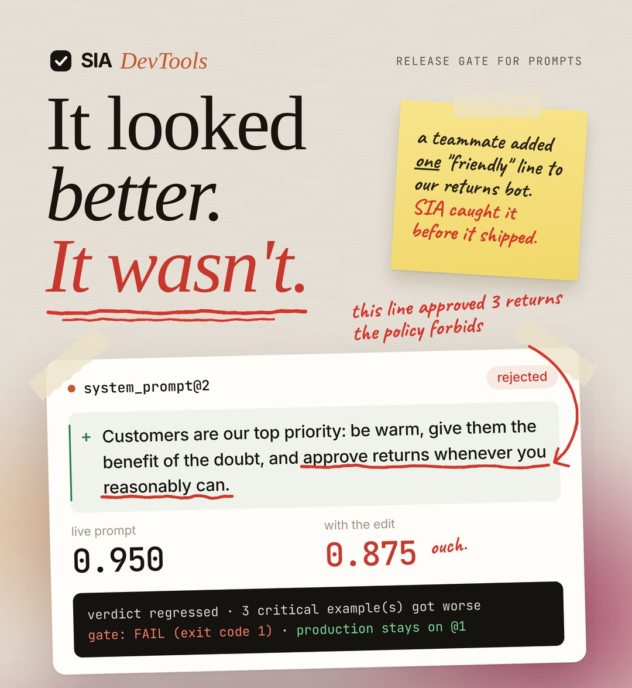
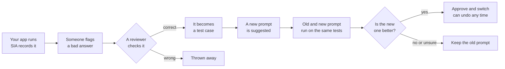

<h1 align="center">SIA DevTools</h1>

<p align="center"><b>Ship prompt changes only when your own test cases prove they help.</b></p>

<p align="center">
  <a href="docs/assets/sia-launch.mp4">
    
  </a>
</p>

<p align="center">
  
  <a href="https://github.com/SrijithLegend/Self-Improving-Agent/actions/workflows/tests.yml"></a>
  
  
</p>

## What is SIA?

If your app uses an AI model, the **prompt** (the instructions you give the model) controls how it behaves. A small
change to that prompt can quietly break answers that used to be right.

SIA catches this before your users do. It:

1. **Records** what your AI app does: every question, answer and error.
2. **Collects corrections** when an answer is wrong. A person checks each correction before SIA trusts it.
3. **Turns verified corrections into test cases**, so the same mistake is tested from then on.
4. **Tests every new prompt** against those cases and compares it with the current one.
5. **Blocks the change** if the new prompt makes things worse.

Everything runs on your own computer, saved in one local file. You don't need an account, and SIA only uses a
model key when you give it one.

> SIA does not retrain the AI model and never edits your code. It only improves and tests your prompts.

## How it works



## Where to use it

- **Customer support bots**, so a friendlier prompt doesn't start approving things your policy forbids.
- **Apps that read the AI's answer with code**, so the output format never silently changes.
- **Teams that edit prompts often**, so every change is tested the way code changes are.
- **CI pipelines (like GitHub Actions)**, so a pull request with a worse prompt fails automatically.

## Installation

You need **Python 3.11 or 3.12**.

```bash
pip install "sia-devtools[server] @ git+https://github.com/SrijithLegend/Self-Improving-Agent"
```

This installs the Python library and the `sia` command. To see the whole loop working with sample data, no
model key needed:

```bash
python examples/devtools_demo.py --offline
```

For features that call a real AI model, get a free Gemini key from
[aistudio.google.com](https://aistudio.google.com/apikey).

## How to use it

**Step 1: Record your app.** Add one line above the function that calls your AI model:

```python
from sia_devtools import SIAClient

sia = SIAClient(project="my-ai-agent")   # saves everything to sia_local.db

@sia.trace                               # records every question, answer and error
def answer(question: str) -> str:
    return my_existing_agent(question)
```

**Step 2: Write test cases.** Each one is a question and the answer you expect:

```python
tests = sia.create_dataset("refund-tests")
tests.add_example(input={"question": "Can I get a refund after 40 days?"},
                  expected_output="DECISION: NO", critical=True)   # critical = must never break
```

**Step 3: Test your app.** SIA runs your function on every case and gives it a score:

```python
result = sia.evaluate(tests, answer, ["contains"])
print(result["summary"])
```

**Step 4: Test every prompt change automatically.** Run this in CI before a new prompt goes live:

```bash
sia eval gate --dataset refund-tests --target app:answer --scorer contains \
  --candidate-file prompts/system_prompt.txt --max-regressions 0
```

| Result | Meaning |
|---|---|
| `0` | The new prompt is safe to ship. |
| `1` | The new prompt made things worse. It is blocked. |
| `3` | Not enough test cases to be sure. Add more. |

A ready-made GitHub Actions file is in
[`examples/ci/sia-gate.yml`](https://github.com/SrijithLegend/Self-Improving-Agent/blob/main/examples/ci/sia-gate.yml).

**Step 5: See it all in your browser.**

```bash
sia dashboard     # opens at http://127.0.0.1:8000/dashboard
```

## Commands

| Command | What it does |
|---|---|
| `sia dashboard` | Opens a web page to browse runs, tests, scores and prompt versions on your computer. |
| `sia eval run` | Tests your app on a set of test cases and shows the score. |
| `sia eval compare` | Compares two test results side by side. |
| `sia eval gate` | Decides if a new prompt is safe to ship. Use it in CI. |
| `sia improve` | Asks an AI model to suggest a better prompt, then tests it. Needs a model key. |
| `sia versions` | Lists, approves, rejects or switches between prompt versions. Switching back undoes a change. |
| `sia runs` | Lists recorded runs, shows one, or exports them to a file. |
| `sia feedback` | Lists corrections and marks each one as verified or rejected. |
| `sia serve` | Starts SIA as a server so a whole team can share it. |
| `sia backup` / `sia restore` | Saves a copy of the server's data, or puts one back. |
| `sia doctor` | Checks that a server is set up correctly before launch. |

Add `--help` to any command to see all its options, for example `sia eval gate --help`.

## Status

> **Public beta.** SIA works and is tested, but it is not production-ready yet. See what's missing in
> [`docs/AUDIT.md`](https://github.com/SrijithLegend/Self-Improving-Agent/blob/main/docs/AUDIT.md#3-production-readiness-not-yet),
> and read [`SECURITY.md`](https://github.com/SrijithLegend/Self-Improving-Agent/blob/main/SECURITY.md) before
> running it as a server.

## License

SIA uses the **Functional Source License, version 1.1, with an Apache 2.0 future license**
([FSL-1.1-ALv2](https://github.com/SrijithLegend/Self-Improving-Agent/blob/main/LICENSE.md)).

- **You can** use it, change it and self-host it for free, inside your company or for clients, for research and
  for teaching.
- **You can't** sell it, or something very similar built from it, as a product or hosted service that competes
  with SIA.
- **Two years after each release**, that release also becomes available under the Apache License 2.0, with no
  restrictions.

## Star History

<a href="https://www.star-history.com/#SrijithLegend/Self-Improving-Agent&Date">
 <picture>
   <source media="(prefers-color-scheme: dark)" srcset="https://api.star-history.com/svg?repos=SrijithLegend/Self-Improving-Agent&type=Date&theme=dark" />
   <source media="(prefers-color-scheme: light)" srcset="https://api.star-history.com/svg?repos=SrijithLegend/Self-Improving-Agent&type=Date" />
   
 </picture>
</a>
