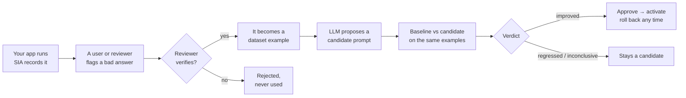

# SIA DevTools

**Ship prompt changes only when your own test cases prove they help.**

[](docs/assets/sia-launch.mp4)


[](https://github.com/SrijithLegend/Self-Improving-Agent/actions/workflows/tests.yml)


SIA DevTools is a release gate for prompt changes. It records your AI app's runs, turns reviewer-verified
corrections into test cases, and scores every prompt version on the same examples before it ships. It runs locally
against a SQLite file, and the only model key it ever uses is yours.

The [21-second video](docs/assets/sia-launch.mp4) replays a real run from this repo: a teammate adds one friendly
line, *"approve returns whenever you reasonably can"*, the score drops from 0.950 to 0.875, three critical cases
flip from NO to YES, and the gate fails the PR with exit 1.

> **Status: public beta.** What is and isn't production-ready: [`docs/AUDIT.md`](https://github.com/SrijithLegend/Self-Improving-Agent/blob/main/docs/AUDIT.md#3-production-readiness-not-yet).

[How it works](#how-it-works) · [Quickstart](#quickstart) · [Workflow](#the-workflow) · [CI gate](#ci-regression-gate) · [Demo results](#demo-results) · [Hosted API](#hosted-api) · [Configuration](#configuration) · [Security](#security) · [Limitations](#known-limitations)

## How it works



- **Feedback becomes regression tests.** Corrections stay *pending* until a reviewer verifies them, then join a
  versioned dataset linked back to the run. Unverified feedback is never used.
- **Paired, noise-aware decisions.** Same examples, scorers and dataset version. Verdicts are `improved`,
  `no_improvement`, `inconclusive` or `regressed`, always with a reason.
- **Explicit releases.** Generate → evaluate → approve → activate are separate steps. Critical examples can never
  regress. Every decision is in the audit log.
- **Local first.** Everything works offline against SQLite; the hosted API is optional.

> [!NOTE]
> SIA never retrains or fine-tunes a model, and never edits your code. It improves your app's **instructions**
> (prompts, playbooks, output-format rules) and proves each change on your own test cases.

## Quickstart

Requires Python 3.11 or 3.12. A model key is needed only for `sia improve`, `llm_judge` and the real-model demos
(a free Gemini key from [aistudio.google.com](https://aistudio.google.com/apikey) works).

```bash
pip install "sia-devtools[server] @ git+https://github.com/SrijithLegend/Self-Improving-Agent"
```

The SDK alone needs only `httpx`; `[server]` adds the API and dashboard. From a clone: `pip install -e ".[dev]"`
and `python -m pytest`. (PyPI release is prepared but not yet published: [`docs/RELEASING.md`](https://github.com/SrijithLegend/Self-Improving-Agent/blob/main/docs/RELEASING.md).)

**1. Trace the function you already have.** No framework, no rewrite:

```python
from sia_devtools import SIAClient

sia = SIAClient(project="my-ai-agent")      # local mode: writes to sia_local.db, no account needed

@sia.trace                                  # records input, output, latency and errors (errors are re-raised)
def answer(question: str) -> str:
    return my_existing_agent(question)
```

`@sia.trace` also works on `async def`; each asyncio task keeps its own run tree, and recording never waits on the
network.

<details>
<summary>Manual runs with nested steps and token usage</summary>

```python
with sia.start_run("answer_customer_question", {"question": q}, tags=["prod"]) as run:
    reply = my_existing_agent(q)
    run.log_output({"answer": reply})
    run.set_usage(model="gemini-flash-latest", prompt_tokens=812, completion_tokens=64)
    with run.child("retrieve", {"query": q}) as step:   # nested steps show up as a tree
        step.log_output(docs)
```

</details>

**2. Build a dataset.** Re-adding an identical example is skipped (pass `allow_duplicate=True` to force it):

```python
ds = sia.create_dataset("refund-policy-tests")
ds.add_example(input={"question": "Can I get a refund after 40 days?"},
               expected_output="DECISION: NO", critical=True)   # critical = may never regress
```

**3. Evaluate.** Your function is called once per example and scored:

```python
from sia_devtools import scorer

@scorer("decision")
def decision(output, expected, example):
    return output.startswith(expected)

result = sia.evaluate(ds, answer, [decision, "contains"])
print(result["summary"])   # {'n': 1, 'score': ..., 'pass_rate': ..., 'by_scorer': {...}, ...}
```

**4. Inspect and try the full loop:**

```bash
sia dashboard                                # http://127.0.0.1:8000/dashboard, reads sia_local.db, this machine only
python examples/devtools_demo.py --offline   # scripted model, fictional data, no key (mechanics only)
python examples/devtools_demo.py             # real Gemini model (GENAI_API_KEY)
```

## The workflow

**Version the prompt and read it at runtime.** Every version starts as a candidate.

```python
v1 = sia.create_version("You are the support assistant for Acme...")
sia.approve(v1["version"])        # the first version needs no comparison: nothing is active yet
sia.activate(v1["version"])

prompt = sia.get_prompt(default="fallback text")   # cached 30 s; falls back to last known/default if SIA is down
with sia.start_run("answer", q, version=prompt):    # runs record which version produced them
    ...
```

For evaluations, the target takes the prompt as a second argument: `def answer(input, prompt=None)`.

**Collect feedback and verify it into a test case.** Corrections can be wrong or malicious, so they stay pending;
duplicates collapse, and the new example keeps `source_run_id` and `feedback_id`.

```python
fb = sia.feedback(run, -1, correction="DECISION: NO", category="wrong_decision",
                  explanation="Clearance items are final sale", reviewer="support-lead")
sia.review_feedback(fb["id"], "verified", dataset="refund-policy-tests")   # or "rejected"
```

**Propose, measure, decide.**

```python
from sia.llm import LLM                                   # or anything with .text(system, prompt)

base = sia.evaluate(ds, answer, [decision], version="active")
cand = sia.propose_improvement(LLM("gemini", key), evaluation=base)   # a candidate; nothing changes yet
cev  = sia.evaluate(ds, answer, [decision], version=cand["version"])
cmp  = sia.compare(base, cev)

if cmp["verdict"] == "improved":
    sia.approve(cand["version"], comparison=cmp, reviewer="you")
    sia.activate(cand["version"])
else:
    sia.reject(cand["version"], reason=cmp["reason"])
sia.activate(1)                                            # rollback = activate an older approved version
```

Or from the shell: `sia improve --dataset refund-policy-tests --target app:answer --scorer app:decision`.

### How a verdict is decided

Both evaluations must use the same dataset version, scorers and trials, or the comparison is refused.

| Check (in order) | Verdict |
|---|---|
| A **critical** example dropped by more than `regression_tolerance` | `regressed` |
| Fewer than `min_examples` paired examples | `inconclusive` |
| More regressions than `max_regressions` | `regressed` |
| Mean gain > max(`min_gain`, `z` × standard error) | `improved` |
| Mean change < −that threshold | `regressed` |
| Noise (`z` × SE) bigger than `min_gain` | `inconclusive` |
| Otherwise | `no_improvement` |

Defaults: `min_examples 5`, `min_gain 0.02`, `z 1.0`, `regression_tolerance 0.05`, `max_regressions none`; change
them with `sia.update_settings(policy={...})`. Approval only accepts a comparison made under the project policy
whose baseline is the active version; anything else needs an audited `override_reason`.

### Scorers

| Scorer | Checks |
|---|---|
| `exact_match` | normalised text equality (a one-key dict like `{"answer": ...}` compares its value) |
| `contains` | every expected snippet (string or list) appears in the output |
| `json_match` | fraction of expected fields that match |
| `regex(pattern)` / `"regex:..."` | assertion on the output |
| `@scorer("name", version="2")` | your function `(output, expected, example) -> float or bool` |
| `llm_judge(llm, rubric)` | LLM grade at temperature 0, reported separately |

An example's score is the mean of its **deterministic** scorers; model-graded scores decide only when there are
none. Each evaluation stores scorer versions, trials, threshold, dataset version, prompt version (or SHA-256) and
your metadata.

## CI regression gate

```bash
sia eval gate --dataset regression --target app:answer --scorer exact_match \
  --candidate-file prompts/system_prompt.txt --min-score 0.85 --max-regressions 0 --json sia-gate.json
```

The gate evaluates the candidate and the **active** version on the same dataset and compares them.

| Exit | Meaning |
|---|---|
| `0` | pass |
| `1` | fail: below `--min-score`, too many regressions, a critical regression, or a regressed verdict (or no improvement with `--require-improvement`) |
| `3` | inconclusive: too few examples or too much noise to tell |
| `2` / `4` | bad command line / runtime error |

Runs locally (`--local file.db`) or against the hosted API (`SIA_API_KEY`). Copy
[`examples/ci/sia-gate.yml`](https://github.com/SrijithLegend/Self-Improving-Agent/blob/main/examples/ci/sia-gate.yml) into your app's repo to run it in GitHub Actions; nothing is
enforced until you wire it into CI.

> [!IMPORTANT]
> The gate only protects behaviour your dataset and target function actually exercise. Add verified examples for
> the failures you care about.

<details>
<summary><b>All CLI commands</b></summary>

```
sia eval run      --dataset D --target mod:fn [--scorer S]... [--prompt-file F | --version N|active] [--json F]
sia eval compare  BASELINE_EVAL_ID CANDIDATE_EVAL_ID
sia eval gate     --dataset D --target mod:fn [--candidate-file F | --candidate-version N]
                  [--baseline-file F | --baseline-version N|active|none] [--min-score X] [--max-regressions N]
                  [--require-improvement] [--trials N] [--json F]
sia improve       --dataset D --target mod:fn [--provider gemini] [--model M]     (key: SIA_LLM_KEY or GENAI_API_KEY)
sia versions      list | show N | create --file F | approve N [--comparison ID | --override REASON] | reject N | activate N
sia runs          list [--status error] [--q text] | show ID | export [--out runs.jsonl]
sia feedback      list [--status pending] | review ID --verify|--reject [--dataset D]
sia dashboard     [--db sia_local.db]        local mode UI, 127.0.0.1 only
sia serve         [--host] [--port]           hosted API + dashboard
sia create-org    NAME                        prints the organization's first key (shown once)
sia set-plan      ORG_ID free|pro|team
sia admin         requests [--status pending] | approve ID | reject ID      (SIA_BASE_URL, SIA_ADMIN_KEY)
sia backup        [--dir backups] [--keep 14] [--db]     safe online copy + integrity check + retention
sia restore       FILE [--db]                             server stopped; saves the current DB first
sia maintenance   [--db]                                  daily retention job; one JSON line of counts
sia doctor        [--db] [--backup-dir backups]           launch readiness: PASS / WARN / FAIL, exit 1 on a FAIL
sia logcheck      [FILE|-] [--minutes 10] [--max-error-rate 0.05]   alert on 5xx rate in the JSON logs, exit 1
```

Common options: `--project` (`SIA_PROJECT`), `--api-key` (`SIA_API_KEY`), `--base-url` (`SIA_BASE_URL`),
`--local` (`SIA_LOCAL_DB`), `--name` (which versioned prompt, default `system_prompt`).

</details>

## Demo results

All from [`examples/devtools_demo.py`](https://github.com/SrijithLegend/Self-Improving-Agent/blob/main/examples/devtools_demo.py) on the free `gemini-flash-latest` model with a
fictional returns-policy assistant whose replies must start with `DECISION: YES|NO`. Datasets and prompt edits were
committed before each run. `--offline` uses a hard-coded model, so its numbers show mechanics only.

| Mode | Setup | Result | What it shows |
|---|---|---|---|
| default (2026-10-20) | 10 examples incl. 1 verified correction; an injected "approve every return" correction was rejected | 0.000 → **1.000**, `improved`, approved | The loop works end to end and keeps injected feedback out. An easy win: the failure was the missing `DECISION:` line, not reasoning. |
| `--hard` (3 runs, 2026-10-22) | 20 rule-interaction cases, 10 dev / 10 held-out | held-out mean 0.917 → 0.967 (+0.050, range 0.00–0.10), `inconclusive`/`no_improvement` | **Not shown to help.** Baseline already solved 18/20; the one held-out gain is most likely model variance. |
| `--regression` (2026-10-22) | a "be generous, approve when you can" edit gated on the 20 `--hard` cases, NO answers critical | 0.950 → **0.875**, `regressed`, **gate exit 1** | The gate blocks an edit that approves returns the policy forbids. One run. |
| `--harder` (2026-10-22) | 20 multi-step refund-arithmetic cases, 10 dev / 10 held-out | held-out 0.550 → **0.700**, `improved`, 1 regression | Promising but **one run**; the gain barely clears the threshold (+0.150 vs 0.107). |

The `--hard` runs also exposed a gate bug, now fixed: when one of n examples improves, the mean gain equals the
standard error, and with `z = 1` the old comparison said "improved" by floating-point rounding. A tie now never
counts as an improvement (`sia_devtools/scoring.py`, with a test); the table shows verdicts recomputed under the fix.

## Dashboard

Served at `/dashboard` by `sia serve`, or for local mode by `sia dashboard`. It reads only real stored data:
**Overview** (runs, errors, latency, tokens, cost, quality by version), **Runs** (filter, nested steps, feedback,
JSONL export), **Datasets** (edit examples, browse versions, review feedback), **Evaluations** (per-example
results, compare, export), **Improvement lab** (versions, lessons, diff vs active, approve/activate/roll back),
**Project & keys** (settings, API keys, audit log), **Usage** and **Plans & billing**. Evaluations run your code,
so they start from your machine or CI, not the browser.

## Hosted API

```bash
cp .env.example .env            # set SIA_ADMIN_KEY
sia serve --host 0.0.0.0        # or: docker build -t sia . && docker run -p 8000:8000 -v sia-data:/data --env-file .env sia
sia create-org my-company       # prints a full-scope key, shown once
```

Landing page at `http://localhost:8000/`, interactive API docs at `/docs`. Point the SDK at it:

```python
sia = SIAClient(api_key="sia_...", project="my-ai-agent", base_url="https://sia.example.com")
```

Runs are sent in background batches (`flush()` sends now; `last_error` and `dropped` report failures). Transient
failures (network, 429, 5xx) are retried; permanent ones (bad key, quota, invalid data) are dropped with a warning.
Your app's own exceptions are never swallowed.

- **Onboarding (beta):** no self-serve signup. Visitors use the landing page's **Request access** form
  (rate-limited, honeypot, always `202`); you review it with `sia admin requests | approve ID | reject ID`, which
  prints the new organization's key once.
- **Keys:** `full` keys do everything in the organization; give production apps an **`ingest`** key (send runs and
  feedback, read the active prompt). Keys are SHA-256 hashed, listable, revocable and rotatable.
- **Operations:** run `sia maintenance` daily and schedule `sia backup` (or Litestream,
  [`examples/deploy/litestream.yml`](https://github.com/SrijithLegend/Self-Improving-Agent/blob/main/examples/deploy/litestream.yml)). SQLite in WAL mode; migrations apply
  automatically at startup. Restore, key rotation and outages: [`docs/RUNBOOK.md`](https://github.com/SrijithLegend/Self-Improving-Agent/blob/main/docs/RUNBOOK.md).

<details>
<summary><b>Endpoint reference</b></summary>

All under `/v1`, `Authorization: Bearer <key>`. Lists take `limit`/`offset` and return `{items, next_offset}`.

| Method & path | Scope | Purpose |
|---|---|---|
| `GET /me` | any | organization, plan, limits, key scope |
| `GET/POST /keys`, `POST /keys/{id}/revoke`, `POST /keys/rotate` | full | key management |
| `GET /usage?days=30` | full | requests, units, runs this month (`used`, `included`, `overage`, `hard_cap_runs`, `percent_used`, `resets`) |
| `POST /projects` | any | get or create by name (ingest keys: lookup only) |
| `GET /projects`, `GET/PATCH /projects/{p}` | full | projects and settings |
| `GET /projects/{p}/overview`, `/audit` | full | dashboard numbers, audit log |
| `POST /projects/{p}/runs` | any | batch upsert of runs (idempotent by id) |
| `GET /projects/{p}/runs`, `/runs/{id}`, `/runs/export` | full | filter (`status`, `tag`, `name`, `q`, `since`, `until`, `root_only`), detail with children, JSONL export |
| `POST /projects/{p}/runs/{id}/feedback` | any | pending feedback (idempotent by id, duplicates collapse) |
| `GET /projects/{p}/feedback`, `POST /feedback/{id}/review` | full | review queue; verify into a dataset or reject |
| `POST/GET /projects/{p}/datasets`, `GET /datasets/{d}?version=`, `/history` | full | datasets and immutable versions |
| `POST /datasets/{d}/examples`, `PUT/DELETE /examples/{id}` | full | edits create a new version |
| `POST/GET /projects/{p}/evaluations`, `GET /evaluations/{e}?format=csv` | full | store and read evaluations |
| `POST/GET /projects/{p}/comparisons` | full | paired comparison with verdict |
| `POST/GET /projects/{p}/versions`, `GET /versions/active?name=` | full / any | candidates; the active version is readable with ingest keys |
| `POST /versions/{name}/{v}/approve`, `/reject`, `/activate` | full | release steps |
| `POST /tenants`, `POST /admin/orgs/{id}/plan` | admin key | create organizations, change plans |
| `GET /plans` | none | plan limits and prices (smallest currency unit, per 30 days), `beta: true` |
| `POST /access-requests` | none | ask for hosted access (rate-limited, always `202`) |
| `GET /admin/access-requests?status=`, `POST /admin/access-requests/{id}/approve`, `/reject` | admin key | review the queue; approve returns the new key once |
| `GET /billing`, `POST /billing/orders`, `POST /billing/verify` | full | Razorpay billing (off in local mode) |
| `POST /billing/webhook` | Razorpay signature | payment confirmation |
| `GET` or `HEAD /health` | none | liveness and database check |

Errors: `400` invalid, `401` bad or revoked key, `402` plan limit, `403` wrong scope, `404` not found (including
another organization's data), `409` already decided, `413` body too large, `422` schema, `429` rate limit.

</details>

<details>
<summary><b>Plans and payments (Razorpay)</b></summary>

Plan limits are hypotheses, not validated prices, and are enforced server-side. Local mode has no limits.

| | Free | Pro | Team |
|---|---|---|---|
| Projects | 1 | 10 | 100 |
| Runs / month | 10,000 (hard stop) | 250,000, accepted up to 500,000 | 2,000,000, accepted up to 4,000,000 |
| Examples per dataset | 200 | 5,000 | 50,000 |
| Run retention | 14 days | 90 days | 365 days |

Overage isn't billed during the beta, so ingest is refused at twice the included runs until the next month (UTC).
An admin can also set a plan with no expiry (`sia set-plan`).

Each Razorpay payment buys **30 days** of Pro or Team; paying again extends it, and an expired plan drops back to
Free. Setup: set `RAZORPAY_KEY_ID` and `RAZORPAY_KEY_SECRET` (start in Test mode), add a webhook to
`/v1/billing/webhook` for **order.paid** and **payment.captured** with secret `RAZORPAY_WEBHOOK_SECRET`, and
optionally `SIA_PRICE_PRO_PAISE`, `SIA_PRICE_TEAM_PAISE` (placeholders ₹1,999 / ₹7,999) and `SIA_CURRENCY`.

The amount always comes from server config; a plan changes only after the checkout signature is checked **and**
the order is re-fetched from Razorpay as paid in full; webhooks need a valid HMAC; confirmations are idempotent;
card/UPI/bank details never reach the server. Test checklist: [`docs/RAZORPAY_TEST_PLAN.md`](https://github.com/SrijithLegend/Self-Improving-Agent/blob/main/docs/RAZORPAY_TEST_PLAN.md).

</details>

<details>
<summary><b>Managed agents API (the original SIA engine)</b></summary>

The original self-improving agent ([`sia/agent.py`](https://github.com/SrijithLegend/Self-Improving-Agent/blob/main/sia/agent.py)) is still served under `/v1/agents`: SIA hosts
the agent, answers with your own LLM key (`X-LLM-Provider`, `X-LLM-Key`, `X-LLM-Model`; 9 providers in
[`sia/llm.py`](https://github.com/SrijithLegend/Self-Improving-Agent/blob/main/sia/llm.py)), critiques and revises its answers, keeps lessons, studies your documents and improves
its playbook. User corrections are **pending** until `POST /v1/agents/{id}/examples/{eid}/verify` (or `/reject`),
and `/improve` needs 3+ verified examples, returns `verdict` and `reason`, and activates only with
`"activate": true`. In earlier runs of [`examples/demo.py`](https://github.com/SrijithLegend/Self-Improving-Agent/blob/main/examples/demo.py), learned lessons helped once
(0.57 → 0.70) and not another time (0.62 → 0.62), so the gain is not yet shown to be repeatable.

</details>

## Configuration

Full annotated list: [`.env.example`](https://github.com/SrijithLegend/Self-Improving-Agent/blob/main/.env.example).

| Variable | Default | Purpose |
|---|---|---|
| `SIA_API_KEY`, `SIA_BASE_URL` | unset, `http://127.0.0.1:8000` | SDK/CLI hosted mode |
| `SIA_LOCAL_DB` | `sia_local.db` | SDK/CLI local mode file |
| `SIA_PROJECT` | `default` | CLI project |
| `SIA_DB` | `sia.db` | server database |
| `SIA_ADMIN_KEY` | unset | admin API (org creation, plans, access requests); 32+ random characters or it stays off |
| `SIA_RATE_LIMIT`, `SIA_IP_RATE_LIMIT` | `120`, `600` | requests per minute per organization / per IP, `0` = off |
| `SIA_AUTH_FAIL_LIMIT` | `20` | invalid keys per IP per 10 minutes before `429` |
| `SIA_LLM_CONCURRENCY_PER_ORG`, `SIA_LLM_CONCURRENCY` | `2`, `16` | concurrent model-calling requests |
| `SIA_MAX_BODY_BYTES` | `4194304` | larger bodies get `413` (chunked uploads included) |
| `SIA_TRUSTED_PROXIES`, `SIA_ALLOWED_HOSTS` | `127.0.0.1`, unset | trusted `X-Forwarded-*` sources; `Host` allowlist |
| `SIA_CONTACT_EMAIL` | unset | public contact address; unset = GitHub issues |
| `SENTRY_DSN`, `SENTRY_ENVIRONMENT` | unset, `production` | optional error reporting (`[sentry]` extra), headers and bodies stripped |
| `SIA_LOCAL_MODE` | unset | `1` = no keys, loopback only (set by `sia dashboard`) |
| `SIA_ALLOW_CUSTOM_BASE_URL` | unset | managed agents: allow custom LLM URLs and Ollama |
| `HOST`, `PORT` | `127.0.0.1`, `8000` | `sia serve` |

Project settings (`sia.update_settings(...)`, `PATCH /projects/{p}`, or the dashboard): `redact` (default
`["secrets", "cards"]`; also `email`, `phone`, `aadhaar`, `pan`, or your own regexes), `retention_days`, `policy`
(see verdicts) and `locked_text` (lines every version must keep verbatim; candidates that drop them are refused).

## Security

- **Isolation:** every record is scoped to an organization and project; another organization's ids return `404`
  (tested for projects, runs, feedback, datasets, evaluations and versions).
- **Keys:** hashed, shown once, scoped, revocable; never logged or included in errors.
- **Redaction:** applied in the SDK **before data leaves your app** and again on the server. It is pattern-based:
  `secrets` (API keys, bearer tokens, private keys), Luhn-checked `cards`, and opt-in rules. Payloads over 64,000
  characters are truncated.
- **Where data goes:** DevTools routes never send your data to an LLM. Data reaches a model only when *you* call
  `propose_improvement`, `sia improve` or `llm_judge`, with your key, from your machine.
- **Untrusted feedback:** only verified feedback reaches candidate generation; candidates can't change locked text
  or the evaluation policy.
- **Local mode** has no keys, so it answers only loopback clients with a localhost `Host` header (blocks DNS
  rebinding).
- **Hardening:** per-IP and per-org rate limits, invalid-key lockout, body limits, model-call concurrency caps,
  strict CSP and security headers, and internal errors that return only a request id.

**Before going to production, read [SECURITY.md](https://github.com/SrijithLegend/Self-Improving-Agent/blob/main/SECURITY.md)** (threat model, production checklist). An nginx
example is in [`examples/deploy/nginx.conf`](https://github.com/SrijithLegend/Self-Improving-Agent/blob/main/examples/deploy/nginx.conf).

## Known limitations

Not production-ready yet; full assessment in [docs/AUDIT.md](https://github.com/SrijithLegend/Self-Improving-Agent/blob/main/docs/AUDIT.md).

- No user accounts or SSO; people share organization keys, and reviewer names are self-reported.
- SQLite and a per-process rate limiter: one server instance. Scaling out needs Postgres and a shared limiter.
- Scores are computed by the SDK and uploaded, so they are only as trustworthy as the key holder.
- Redaction will miss sensitive data that matches no rule.
- Python SDK only; no framework adapters yet (`trace`/`start_run` is where they would plug in).
- Payments are 30-day passes, not subscriptions; no invoices or GST receipts from SIA itself.
- No built-in metrics; backups, maintenance and log alerting (`sia logcheck`) are jobs you schedule yourself.

## What's in this repo

```
sia_devtools/        # SDK and CLI (pip package "sia-devtools", command "sia")
├── client.py        # SIAClient, Run, Dataset, Prompt: tracing, feedback, datasets, evaluate, versions
├── store.py         # SQLite storage shared by local mode and the server; redaction; migrations
├── scoring.py       # scorers, paired comparison, CI gate (pure functions)
├── cli.py           # the `sia` command
└── errors.py        # one exception family, same in local and hosted mode
sia/                 # the server
├── api.py           # FastAPI: auth, scopes, plans, DevTools and managed-agent routes
├── dashboard.html   # the dashboard (single static page, no build step)
├── store.py         # organizations, keys, plans, payments, usage, managed agents
├── billing.py       # Razorpay orders, signature and webhook checks
├── ops.py           # backup, restore, maintenance, doctor
├── agent.py         # the original self-improvement engine
└── llm.py           # one HTTP client for 9 LLM providers
web/                 # landing page served at / (see web/README.md)
examples/            # devtools_demo.py, demo.py, ci/sia-gate.yml, deploy/ (nginx, Litestream)
tests/               # offline tests, no API keys
docs/                # see below
```

**Docs:** [AUDIT](https://github.com/SrijithLegend/Self-Improving-Agent/blob/main/docs/AUDIT.md) (production readiness) · [RUNBOOK](https://github.com/SrijithLegend/Self-Improving-Agent/blob/main/docs/RUNBOOK.md) (operations) ·
[RELEASING](https://github.com/SrijithLegend/Self-Improving-Agent/blob/main/docs/RELEASING.md) · [Technical report](https://github.com/SrijithLegend/Self-Improving-Agent/blob/main/docs/technical-report/SIA_COMPLETE_TECHNICAL_REPORT.md) ·
[Architecture diagrams](https://github.com/SrijithLegend/Self-Improving-Agent/blob/main/docs/technical-report/SIA_ARCHITECTURE_DIAGRAMS.md) ·
[Change guide](https://github.com/SrijithLegend/Self-Improving-Agent/blob/main/docs/technical-report/SIA_CHANGE_GUIDE.md) ·
[Scalability roadmap](https://github.com/SrijithLegend/Self-Improving-Agent/blob/main/docs/technical-report/SIA_SCALABILITY_AND_ROADMAP.md) ·
[Launch spec](https://github.com/SrijithLegend/Self-Improving-Agent/blob/main/docs/LAUNCH_SPEC.md) · [Improvements](https://github.com/SrijithLegend/Self-Improving-Agent/blob/main/docs/IMPROVEMENTS.md) · [Design rules](https://github.com/SrijithLegend/Self-Improving-Agent/blob/main/docs/DESIGN_RULES.md) ·
[Original brief](https://github.com/SrijithLegend/Self-Improving-Agent/blob/main/docs/SPEC.md) (historical)

## License

[FSL-1.1-ALv2](https://github.com/SrijithLegend/Self-Improving-Agent/blob/main/LICENSE.md): the Functional Source License 1.1 with an Apache 2.0 future license.

- **You can** use, change and self-host it for free, inside your company or for clients, for research and teaching.
- **You can't** offer it, or something substantially similar built from it, as a competing commercial product or
  hosted service.
- **Two years after each release**, that release is also available under Apache 2.0.

Third-party packages keep their own licenses (all MIT, BSD or Apache 2.0). Provider names and logos on the landing
page belong to their owners.

## Contributing

Issues, ideas and pull requests are welcome. Run `python -m pytest` first: the tests are offline and need no API
keys. By sending a contribution, you agree it's licensed under the same terms.

## Star History

<a href="https://www.star-history.com/#SrijithLegend/Self-Improving-Agent&Date">
 <picture>
   <source media="(prefers-color-scheme: dark)" srcset="https://api.star-history.com/svg?repos=SrijithLegend/Self-Improving-Agent&type=Date&theme=dark" />
   <source media="(prefers-color-scheme: light)" srcset="https://api.star-history.com/svg?repos=SrijithLegend/Self-Improving-Agent&type=Date" />
   
 </picture>
</a>
