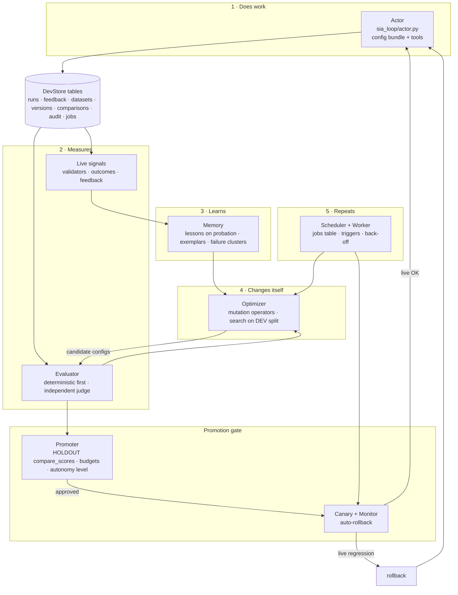

# SELF_IMPROVING_SPEC.md: Turning SIA into a true self-improving agent

**Audience:** Claude Code (or you) implementing this in `SrijithLegend/Self-Improving-Agent`.
**Code baseline:** `origin/main` at `db045da`. Its Python code is identical to `72be749`, the commit the technical
report inspected, so every file and line reference below is valid against both.
**Rule for the implementer:** follow the phases in order. Each phase ends green: all old tests pass, plus the new
tests listed for that phase. Don't start a phase until the previous one is merged.

---

## 0. Decision summary (read this first)

### 0.1 What "true self-improving" means in this spec

An agent that, **without a human editing anything**:

1. **does work** (answers tasks, calls tools),
2. **measures how well it did** with a signal it can't fake,
3. **learns** from the results,
4. **changes its own behaviour**: prompt, playbook, lessons, few-shot examples, retrieval settings, tool usage,
   tool definitions, output validators and model choice,
5. **repeats on its own**, on a schedule or when triggered, and keeps a change only if it is measurably better on
   data it never trained on, with automatic rollback if live traffic disagrees.

### 0.2 Do we delete SIA DevTools? **No. We merge, and delete the duplicates.**

Deleting DevTools would delete exactly the parts a self-improving agent can't work without:

| A self-improving agent needs… | DevTools already has it |
|---|---|
| A trustworthy grader | Deterministic scorers that outrank LLM judges (`scoring.primary_score`) |
| A fixed exam that can be reproduced | Immutable, versioned datasets (`added_in` / `removed_in`) |
| A noise-aware "is this really better?" rule | `compare_scores` (paired, standard error, critical examples) |
| Versions plus rollback | `versions` + `active_versions` + `activate` |
| A memory of what happened | `runs` + `feedback` + `audit` |
| A release gate | `approve` (needs an `improved` comparison) + `sia eval gate` |

What **is** deleted is the managed-agent code that duplicates those parts badly:

| Delete / replace | Why | Replaced by |
|---|---|---|
| `examples` table (`sia/store.py`) | Parallel eval set; synthetic examples auto-verified | `dataset_examples` with `split` + `status` |
| `playbooks` table | Parallel versioning, race S4, two active rows possible | `versions` with `name='agent_config'` |
| `episodes` table | Parallel run log | `runs` (+ `feedback`) |
| `Agent.scores`, `Agent.evaluate`, `Agent.improve` | Self-graded: the actor model grades itself, often with no answer key | `sia_loop` evaluator + optimizer + promoter |
| `Agent.study` writing **verified** synthetic examples | The model writes its own exam | Synthetic examples are `pending` and `dev`-only |
| Lessons injected into production the moment they're written | Prompt-injection persistence (report P1); unevaluated behaviour change | Lessons enter a **candidate config** and only reach production through the promotion gate |
| Synchronous `/study`, `/evaluate`, `/improve` routes | Hold a thread for minutes (report P9) | Background jobs |

**The product after this spec:** one system with an **autonomy dial**. Autonomy 0 is today's DevTools (a human
does every step). Autonomy 3 is a closed loop. Same tables, same gate, same audit log.

### 0.3 Non-negotiable safety properties

A closed loop that grades itself gets worse while reporting that it's getting better. These properties are what
separate a self-improving agent from a self-deceiving one. Every phase must keep all of them:

| # | Property | Enforced by |
|---|---|---|
| G1 | **The actor never grades itself for promotion.** The promotion signal is deterministic scorers, or an LLM judge on a *different* model, against human-verified expected outputs | `evaluator.py` refuses `judge.model == actor.model` unless `settings.loop.allow_same_model_judge` |
| G2 | **Held-out data is never seen by the optimizer.** Promotion is decided on the `holdout` split only | `optimizer.py` loads `split='dev'` only; a test asserts no holdout input appears in any optimizer prompt |
| G3 | **Critical examples can never regress** | Existing `compare_scores` rule, unchanged |
| G4 | **Locked text survives every mutation** | Existing `locked_text` check, extended to every prompt field of the config bundle |
| G5 | **Hard budgets.** Per-cycle and per-month LLM-call caps; the loop stops when they're hit | `budget.py` + plan quota (fixes S3) |
| G6 | **Live traffic is the final judge.** Canary first, automatic rollback on live regression | `monitor.py` |
| G7 | **Kill switch.** One call stops all autonomous changes and leaves the active version alone | `POST /v1/projects/{pid}/loop/pause`, `settings.loop.autonomy = 0` |
| G8 | **Every autonomous action is audited** with actor `sia-loop` and the evidence that justified it | Existing `audit` table |
| G9 | **Unverified human text never becomes ground truth automatically** | Feedback stays `pending`; only deterministic outcome signals may auto-verify, and only if enabled |
| G10 | **No arbitrary code execution.** Agent-created tools are declarative (prompt templates, schemas, compositions of built-ins), never Python | `tools/registry.py` has no `exec`, `eval`, subprocess or import of agent-supplied code |

### 0.4 Honest claims (put these in the README when Phase 6 ships)

- **Allowed to say:** "SIA agents improve their own prompts, examples, retrieval and tool use automatically. A
  change ships only after it beats the current version on held-out tests, passes a live canary, and keeps every
  critical case."
- **Not allowed until measured (§12):** "gets better forever", "learns like a human", "trains itself". **Never say
  "retrains"**: no model weights change anywhere in this spec.

---

## 1. Prerequisites: fix S1–S4 first (Phase 0)

The loop multiplies whatever is broken, so these come first. Details are in the technical report, Chapter 15.

| ID | Fix | Files | Test |
|---|---|---|---|
| S1 | Custom redaction regexes: allow only `REDACTORS` names on the hosted server; run custom patterns only in local mode; redact **before** `BEGIN IMMEDIATE`; cap scanned text at 64,000 chars | `sia_devtools/store.py` (`validate_settings`, `log_runs`, `add_feedback`, `_example_rows`) | `test_custom_regex_cannot_stall_writes`: `(a+)+$` on 40 `a`s + `!` finishes in < 1 s, or is refused on the hosted server |
| S2 | `DELETE /v1/projects/{pid}` and `DELETE /v1/admin/orgs/{org}`, removing every row by `project_id` / `org_id` in one transaction (keep `usage` rows, anonymised) | `sia_devtools/store.py`, `sia/store.py`, `sia/api.py` | `test_delete_org_leaves_no_rows`: iterate every table and assert 0 rows for that org |
| S3 | Per-plan monthly `llm_calls` quota enforced in `metered()` (402 when exceeded); `sia doctor` FAILs if `SIA_DEFAULT_LLM_KEY` is set while more than 1 org exists | `sia/api.py`, `sia/store.py` (`PLANS`), `sia/ops.py` | `test_llm_quota_returns_402` |
| S4 | `Store._conn(write=True)` uses `BEGIN IMMEDIATE`, like `DevStore`; add `UNIQUE(agent_id, version)` on `playbooks` (temporary: the table is deleted in Phase 2) | `sia/store.py` | `test_concurrent_add_playbook_unique`: 4 threads × 150 writes → 600 distinct versions (fails today: 79 duplicates) |

**Exit criteria, Phase 0:** all 110 existing tests + 4 new tests pass.

---

## 2. Target architecture



### 2.1 New package layout

```
sia_loop/                    new package, server side, no FastAPI import
├── __init__.py
├── config.py                AgentConfig schema, validation, diff, locked-text check
├── actor.py                 runs a task with a config: tool loop, revise loop, validators
├── tools/
│   ├── registry.py          built-in tools + declarative agent-made tools (no code exec)
│   ├── builtin.py           search_knowledge, calculator, lookup_table, http_get (off by default)
│   └── macro.py             agent-authored tools: prompt-template tools and pipelines of built-ins
├── memory.py                lessons (probation → proven), exemplars, failure clustering
├── evaluator.py             server-side evaluation of a config on a dataset split
├── optimizer.py             mutation operators + search (dev split only)
├── promoter.py              holdout gate, autonomy levels, approve/activate as actor "sia-loop"
├── monitor.py               canary traffic split, live metrics, auto-rollback
├── budget.py                per-cycle / per-month LLM-call accounting
├── jobs.py                  jobs table access, worker loop, triggers
└── cycle.py                 one improvement cycle, end to end (the "main" of the loop)
```

`sia/agent.py` shrinks to a thin compatibility wrapper (Phase 2) and is deleted in Phase 7.

### 2.2 One concept of "project" for both kinds of work

| Project kind | Who does the work | Who runs the loop | Notes |
|---|---|---|---|
| `kind = "agent"` (hosted) | SIA's actor, on the server | The server worker (`sia worker`) | Full autonomy 0–3 |
| `kind = "app"` (your own app, today's DevTools) | Your code, through `@sia.trace` | Your machine or CI: `sia loop run --target app:answer` | Autonomy 0–2; level 3 needs the SDK canary support in §8.3 |

Managed agents become projects with `kind = "agent"`. `/v1/agents/*` stays as a deprecated alias for one release
(Phase 7 removes it).

---

## 3. The agent config bundle: what the agent can change about itself

Everything the agent may change lives in **one versioned JSON document**, stored in the existing `versions` table
with `name = "agent_config"` (content = JSON text, ≤ 50,000 chars, the existing limit). Versioning, approval,
activation, rollback and audit come for free.

### 3.1 Schema (`sia_loop/config.py`)

```python
AGENT_CONFIG_SCHEMA_VERSION = 1

DEFAULT_CONFIG = {
    "schema": 1,
    "system_prompt": "",          # role + instructions (locked_text applies here)
    "playbook": "",               # strategy: principles, procedures, checks (<= 600 words)
    "lessons": [],                # list of lesson ids pinned into the prompt (max 12); text lives in `lessons`
    "exemplars": [],              # list of dataset example ids used as few-shot demos (DEV split only, max 6)
    "retrieval": {"enabled": True, "k": 5, "max_chars_per_chunk": 1000},
    "tools": {
        "enabled": ["search_knowledge", "calculator"],   # names from the registry
        "macros": [],             # agent-authored declarative tools, see §4.3
        "max_steps": 6,           # tool-loop step limit per task
    },
    "validators": [],             # output checks run on every answer: {"type": "regex"|"json_schema", ...}
    "revise": {"max_revisions": 2, "pass_score": 0.75, "critic": "self"},  # inner loop; never used for promotion
    "model": {"provider": "gemini", "chain": ["gemini-flash-latest"], "temperature": 0.3},
}
```

**Validation rules (enforced on every write, in `config.validate(cfg, project_settings)`):**

| Field | Rule |
|---|---|
| `system_prompt`, `playbook`, every macro `template` | Must contain every `settings.locked_text` line verbatim (G4) |
| `lessons` | Ids must exist and belong to this project; max 12 |
| `exemplars` | Ids must be in the project's eval dataset with `split='dev'` (never holdout, G2); max 6 |
| `tools.enabled` | Subset of the registry **and** of `settings.loop.allowed_tools` |
| `model.chain` | Every model in `settings.loop.allowed_models` (the operator picks what the agent may switch to) |
| `retrieval.k` | 0–10 |
| `validators` | Regex ≤ 200 chars, compiled with the S1 time-budget rule; JSON schema ≤ 5,000 chars |
| Total size | ≤ 50,000 chars serialized |

`config.diff(a, b)` returns a human-readable list of changes (`"playbook: +2 bullets"`,
`"lessons: +#41 −#12"`, `"retrieval.k: 5 → 3"`). It is stored in the version's `note` and shown in the dashboard.

---

## 4. Actor and tools (Phase 3)

### 4.1 Actor loop (`sia_loop/actor.py`)

A provider-neutral **JSON action loop**: it uses only `LLM.json`, so it works on all 9 providers without native
function calling.

```python
def run_task(cfg: dict, task: str, ctx: ActorContext) -> ActorResult:
    system = build_system(cfg, ctx)            # system_prompt + playbook + pinned lessons + exemplars + tool specs
    steps, transcript = 0, []
    while steps < cfg["tools"]["max_steps"]:
        act = ctx.llm.json(system, render(task, transcript), temperature=cfg["model"]["temperature"])
        if "final" in act:
            answer = str(act["final"])
            break
        tool, args = act.get("tool"), act.get("args") or {}
        out = ctx.tools.call(tool, args, cfg)  # unknown or disabled tool -> error string back to the model
        transcript.append({"tool": tool, "args": args, "result": out[:4000]})
        steps += 1
    else:
        answer = ctx.llm.text(system, render(task, transcript) + "\nGive your final answer now.")
    answer = revise_if_needed(cfg, task, answer, ctx)   # existing draft-critique-revise, from agent.py
    checks = run_validators(cfg["validators"], answer)  # deterministic, cheap, recorded on the run
    return ActorResult(answer, transcript, checks, ctx.llm.calls)
```

- Every task is logged as a DevTools **run** (`log_runs`) with `version_name="agent_config"`, `version=N`, the tool
  transcript as child runs (`parent_id`), and `scores = {"validator:<name>": 0|1}`.
- The self-critique revise loop is kept as a **runtime** feature. Its scores are stored as
  `scores["self_critique"]`, but the evaluator and the promoter ignore them (G1).

### 4.2 Built-in tools (`sia_loop/tools/builtin.py`)

| Tool | Does | Safety |
|---|---|---|
| `search_knowledge(query, k)` | FTS5 search over the project's documents (moved from `Store.search_chunks`, same `fts_query` sanitising) | Scoped by `project_id` |
| `calculator(expression)` | Arithmetic via an AST whitelist (numbers, + − × ÷ % **, parentheses, `round`, `min`, `max`) | No names, no calls beyond the whitelist, length ≤ 200 |
| `lookup_table(table, where)` | Exact-match lookup in a CSV or JSON table the operator uploaded (`POST /v1/projects/{pid}/tables`) | Read-only; ≤ 5 MB per table |
| `http_get(url)` | **Off by default.** GET only, to hosts in `settings.loop.http_allowlist` | Reuses the SSRF rules from `llm.py`; 5 s timeout; 100 KB cap; no redirects |

### 4.3 Agent-created tools: declarative only (`sia_loop/tools/macro.py`)

This is how the agent "changes its own tools" without code execution (G10). A macro is data:

```json
{"name": "refund_window_check",
 "description": "Decide whether a purchase is inside the return window.",
 "kind": "prompt",
 "input_schema": {"type": "object", "properties": {"days": {"type": "integer"}, "member": {"type": "boolean"}},
                  "required": ["days", "member"]},
 "template": "Policy windows: members 60 days, others 30 days. days={days}, member={member}. Reply WITHIN or OUTSIDE.",
 "output_schema": {"type": "string", "enum": ["WITHIN", "OUTSIDE"]}}
```

or a pipeline of built-ins:

```json
{"name": "policy_then_math", "kind": "pipeline",
 "steps": [{"tool": "search_knowledge", "args": {"query": "{query}", "k": 3}},
           {"tool": "calculator", "args": {"expression": "{expression}"}}]}
```

- `kind="prompt"` runs one `LLM.json` call with the filled template and validates the output against
  `output_schema`.
- `kind="pipeline"` runs built-ins in order with string templating only (no loops, no conditionals, ≤ 5 steps).
- Macros live in `cfg["tools"]["macros"]`, so they are versioned, evaluated and promoted like every other change.
- **Out of scope (and why):** agent-written Python tools. Running model-written code on a multi-tenant server needs a
  real sandbox (gVisor or Firecracker), resource limits and egress control. That is a separate product decision,
  marked P3 in §13.

---

## 5. Signals: how it knows how well it did (Phase 1 + Phase 3)

| Signal | Source | Trust | Used for |
|---|---|---|---|
| Deterministic eval scores | Scorers on `holdout`/`dev` examples with verified expected outputs | **High** | Optimizer (dev), promotion (holdout) |
| Independent judge | `llm_judge` on a model ≠ actor model, against verified expected outputs | Medium | Only when no deterministic scorer exists; promotion still requires `primary_score` semantics |
| Live validator pass rate | `cfg.validators` on every production run | High (narrow) | Canary monitor, failure mining |
| Outcome signals | New `POST /v1/projects/{pid}/runs/{rid}/outcome {"ok": bool, "source": "..."}` from the customer's system (for example "the refund was actually reversed") | High if the source is a system, not a person | Canary monitor; may auto-verify into **dev** if `settings.loop.auto_verify_outcomes` |
| User feedback (±1, correction) | Existing `feedback` | Low until verified | Pending → human verify → dataset (G9) |
| Self-critique | Actor's own critic | **Lowest** | Runtime revisions only; never promotion (G1) |

### 5.1 Dataset changes (migration `devtools-002`)

```sql
ALTER TABLE dataset_examples ADD COLUMN split TEXT NOT NULL DEFAULT 'dev';      -- 'dev' | 'holdout'
ALTER TABLE dataset_examples ADD COLUMN status TEXT NOT NULL DEFAULT 'verified'; -- 'verified' | 'pending'
CREATE INDEX IF NOT EXISTS idx_dataset_examples_split ON dataset_examples(dataset_id, split);
```

- **Split assignment** happens at insert, deterministic and stable:
  `holdout if int(sha256(f"{dataset_id}:{root}").hexdigest(), 16) % 100 < settings.loop.holdout_pct`
  (default 30), where `root` is the original example id, following `replaces`. Edited examples keep their split.
  Back-fill existing rows in the same deterministic way on first `migrate()` after the upgrade, in a one-time
  Python step guarded by a `schema_migrations` row `devtools-002-backfill`.
- `critical` examples go to **both** splits' gate checks: the promoter runs every critical example regardless of
  split.
- `pending` examples are excluded from snapshots used for evaluation. `study()`-style synthetic examples are
  inserted as `pending` with `split='dev'` forced (G2, G9).
- `DevStore.dataset(..., split=None)` and `SIAClient.evaluate(..., split=None)` gain a `split` filter. The default
  `None` keeps today's behaviour, so existing users see no change.

---

## 6. Memory: how it learns (Phase 4)

### 6.1 Lessons, rebuilt (`sia_loop/memory.py`)

Today a lesson goes live in the prompt the moment it's written. In this spec:

| State | Meaning | In the production prompt? |
|---|---|---|
| `probation` | Just extracted by reflection or verification | **No** |
| `pinned` | Included in an `agent_config` version that passed the promotion gate | Yes, through that version only |
| `retired` | Removed by the optimizer, or vetoed by a human | No |

- Reflection still runs after each production task (cheap, ≤ 1 call) but only **writes `probation` lessons**.
- Lessons are scrubbed before storage: drop any lesson that contains instruction-override patterns ("ignore",
  "system prompt", "you must always", URLs, emails, code fences) or that is more than 40% overlap with a single task's
  text (a memorised fact, not a lesson).
- Utility is recomputed from **trusted signals only**: deterministic validator results, outcomes and verified
  feedback on runs where the lesson was pinned. Self-critique credit is removed (fixes the self-grading inflation).
- Migration `legacy-004`: `ALTER TABLE lessons ADD COLUMN state TEXT NOT NULL DEFAULT 'probation'` and a
  `project_id` column, back-filled from `agents` → project mapping (§10).

### 6.2 Exemplars

Verified dev examples that the active config answers correctly become exemplar candidates. The optimizer may swap
them into `cfg.exemplars` (few-shot). Holdout examples can never be exemplars (validated in `config.validate`).

### 6.3 Failure clustering

`memory.failure_clusters(project, since)` groups recent failures (dev eval failures, validator failures, negative
outcomes, verified corrections) by a cheap key: scorer name + first 6 normalised words of the expected output +
validator name. It returns the top 10 clusters with counts and 3 representative examples each. This is the
optimizer's main evidence. It reuses the pattern counting in `SIAClient.propose_improvement`.

---

## 7. Optimizer: how it changes itself (Phase 4)

### 7.1 Mutation operators (`sia_loop/optimizer.py`)

Each operator takes `(active_cfg, evidence) → candidate_cfg` and is either an LLM call or a deterministic edit:

| Operator | Kind | What it changes | LLM calls |
|---|---|---|---|
| `rewrite_playbook` | LLM | Playbook rewritten from failure clusters + probation lessons (today's `Agent.improve` prompt, minus self-grading) | 1 |
| `edit_system_prompt` | LLM | Minimal edit to the system prompt that targets the top cluster; locked text kept | 1 |
| `pin_lessons` / `unpin_lessons` | Deterministic | Add the top-k probation lessons by trusted utility; drop pinned lessons with low utility | 0 |
| `swap_exemplars` | Deterministic | Replace the exemplars with dev examples from the top failure clusters that a sibling candidate got right | 0 |
| `tune_retrieval` | Deterministic | `k ∈ {0, 3, 5, 8}`; `enabled` on/off | 0 |
| `add_validator` | LLM | Proposes a regex or JSON-schema validator from the output-format failures; must pass on ≥ 95% of verified expected outputs before it is accepted | 1 |
| `create_macro_tool` | LLM | Proposes one declarative macro (§4.3) for a recurring sub-task seen in the tool transcripts | 1 |
| `toggle_tools` | Deterministic | Enable or disable an allowed tool | 0 |
| `switch_model` | Deterministic | Next model in `allowed_models` (cost-aware: only to a cheaper model unless the cluster is a quality failure) | 0 |

### 7.2 Search procedure (one cycle)

```text
evidence   = memory.failure_clusters(dev failures + live signals)           # DEV + live only, never holdout
proposals  = pick K operators (default K=4) weighted by evidence type        # e.g. format failures -> add_validator
candidates = [op(active_cfg, evidence) for op in proposals]                 # 0-1 LLM call each
candidates = [c for c in candidates if config.validate(c) passes]            # locked text, allowlists, sizes

# Stage 1: cheap screen on a DEV subset (min(20, |dev|) examples, 1 trial)
screen     = evaluator.run(c, split="dev", limit=20) for each candidate
survivors  = top 2 by mean score, only if they beat active on the same subset

# Stage 2: full DEV, trials = settings.loop.trials (default 2)
best       = argmax over survivors of evaluator.run(c, split="dev")
if compare_scores(active_dev, best_dev).verdict != "improved": stop (no change this cycle)

# Stage 3: HOLDOUT decides (never seen by any step above)
cmp        = evaluator.compare(active, best, split="holdout") + all critical examples
hand cmp to promoter
```

- Combining operators: after a candidate wins, the next cycle starts from the new active config, so changes stack one
  verified step at a time. No crossover, no population. That keeps the audit trail readable.
- Every candidate is stored with `create_version(name="agent_config", content=json, parent_version=active, note=diff)`.
  Losing candidates are `reject`ed with the comparison's reason, so the history shows what was tried.

### 7.3 Cost per cycle (formula, to show in the dashboard)

```
calls ≈ K·(operator calls ≤ 1)
      + K·screen_n·(actor calls per task)                       # stage 1
      + 2·(|dev|·trials·actor calls)                           # stage 2: 2 survivors
      + (|dev|·trials·actor calls)                             # active on full dev
      + 2·(|holdout|·trials·actor calls)                       # stage 3: active + best
      + judge calls if model-graded
```

`budget.py` estimates this before starting and refuses the cycle (job status `skipped_budget`) if it exceeds
`settings.loop.max_calls_per_cycle` (default 400) or the remaining monthly quota (S3).

---

## 8. Promotion, canary, rollback (Phase 5)

### 8.1 Autonomy levels (`settings.loop.autonomy`, per project)

| Level | Name | Loop creates candidates? | Approves? | Activates? | Default for |
|---|---|---|---|---|---|
| 0 | Manual | No (a human runs `sia improve`) | Human | Human | Existing projects after upgrade |
| 1 | Propose | Yes, automatically | Human | Human | New `kind="app"` projects |
| 2 | Canary | Yes | **Loop** (only on `improved` holdout verdict) | **Canary only** (X% traffic); a human promotes to 100% | New `kind="agent"` projects |
| 3 | Autonomous | Yes | Loop | Loop: canary, then 100% if the monitor passes | Opt-in only |

Changing autonomy is a full-scope-key action and is audited. Lowering it takes effect immediately; raising it to 3
requires `settings.loop.holdout_min_examples ≥ 20` and at least one critical example. Otherwise it's refused with
the reason.

### 8.2 Promoter rules (`sia_loop/promoter.py`)

The promoter approves as actor `"sia-loop"` only when **all** hold:

1. Holdout comparison verdict is `improved` under the **project policy** (no overrides; reuse
   `DevStore.approve`'s existing checks).
2. Zero critical regressions across **all** critical examples (both splits).
3. `config.validate` passes and `locked_text` is intact (G4).
4. The holdout has ≥ `holdout_min_examples` (default 20) verified examples.
5. Promotions in the last 24 h < `settings.loop.max_promotions_per_day` (default 2).
6. The judge was deterministic, or a model different from the actor's (G1).
7. The loop is not paused (G7).

Otherwise the candidate stays `candidate` (levels 1–3), and a notification is emitted (§9.3).

### 8.3 Canary traffic split

Migration `devtools-003`:

```sql
ALTER TABLE active_versions ADD COLUMN canary_version INTEGER;
ALTER TABLE active_versions ADD COLUMN canary_pct INTEGER NOT NULL DEFAULT 0;    -- 0..50
ALTER TABLE active_versions ADD COLUMN canary_started REAL;
```

- `DevStore.start_canary(org, pid, name, version, pct)` requires `status='approved'`.
  `promote_canary` makes it active; `stop_canary` clears it. All three are audited.
- **Hosted agents:** the actor picks the canary config when `hash(run_id) % 100 < canary_pct`.
- **Your app (SDK):** `get_prompt(name, unit=None)`. If `unit` (for example a user id) is given and a canary
  exists, it returns the canary text for `hash(unit) % 100 < canary_pct`, so a user sticks to one variant. The
  `Prompt` object carries the version, so traced runs record which variant served them. `GET /versions/active`
  gains an optional `unit` query parameter. Without `unit`, behaviour is unchanged.

### 8.4 Live monitor and auto-rollback (`sia_loop/monitor.py`)

Runs every 10 minutes (worker job) while a canary is live:

| Metric per variant (canary vs active, same time window) | Failure if |
|---|---|
| Error rate (`runs.status='error'`) | Canary worse by a two-proportion z-test, z > 2.0 |
| Validator fail rate | Same test |
| Negative outcome rate (outcome signals) | Same test |
| Negative feedback rate (rating −1) | Same test, but only counts after ≥ 30 ratings per variant |

- **Minimum sample:** no decision before ≥ `settings.loop.canary_min_runs` (default 200) runs per variant.
- **Rollback:** any failing metric means `stop_canary`, `reject` the version with the metric and numbers as the
  reason, audit, notify. Production never left the active version, so nothing else needs undoing.
- **Promote (level 3):** after `canary_min_runs` with no failing metric and at least `canary_min_hours` (default 24),
  `promote_canary`. Level 2 notifies a human instead.
- **Post-promotion watch:** for 48 h after a promotion, the same tests run new-active vs previous-active on
  historical baselines; a failure re-activates the previous version (it is still `approved`, so this is the
  existing rollback).

---

## 9. Scheduler, jobs, notifications (Phase 1 infrastructure; triggers in Phase 6)

### 9.1 Jobs table (migration `devtools-004`)

```sql
CREATE TABLE IF NOT EXISTS jobs (id TEXT PRIMARY KEY, project_id TEXT NOT NULL, kind TEXT NOT NULL,
    status TEXT NOT NULL DEFAULT 'queued',     -- queued | running | done | failed | skipped_budget | cancelled
    payload TEXT, result TEXT, error TEXT, attempts INTEGER NOT NULL DEFAULT 0,
    run_after REAL, started REAL, finished REAL, created REAL, locked_by TEXT, heartbeat REAL);
CREATE INDEX IF NOT EXISTS idx_jobs_queue ON jobs(status, run_after);
```

- `sia worker` (new CLI command) claims jobs with
  `UPDATE jobs SET status='running', locked_by=?, heartbeat=? WHERE id=(SELECT id FROM jobs WHERE status='queued' AND run_after<=? ORDER BY created LIMIT 1) RETURNING *`
  inside `BEGIN IMMEDIATE`. It heartbeats every 30 s. A job whose heartbeat is older than 5 minutes goes back to
  `queued` (max 3 attempts, then `failed`).
- Job kinds: `cycle` (one improvement cycle), `monitor` (canary check), `evaluate` (manual eval of a config),
  `study` (synthetic pending examples).
- `GET /v1/projects/{pid}/jobs`, `GET /v1/jobs/{id}`, `POST /v1/jobs/{id}/cancel`.
- `/v1/agents/{id}/study|evaluate|improve` return `202 {"job_id": ...}` instead of blocking.

### 9.2 Triggers (`sia_loop/jobs.py`)

A `cycle` job is enqueued for a project when **any** of these fires and none is already queued or running:

| Trigger | Default |
|---|---|
| Schedule | `settings.loop.every_hours` (default 24) |
| New verified examples since the last cycle | ≥ 10 |
| Live failure-rate rise (validators + outcomes, last 24 h vs previous 7 d) | z > 2.0 and ≥ 100 runs |
| Manual | `POST /v1/projects/{pid}/loop/run` or `sia loop run` |

**Back-off:** after 3 consecutive cycles with no promotion, `every_hours` doubles (capped at 7 days) until a
promotion or a data trigger resets it. That's the "plateau" rule: it stops burning budget once it has stopped
learning.

### 9.3 Notifications

`settings.loop.webhook_url` (optional, HTTPS only, HMAC-signed with a per-project secret). It receives events:
`candidate.created`, `candidate.rejected`, `version.auto_approved`, `canary.started`, `canary.rolled_back`,
`canary.promoted`, `loop.paused`, `budget.exhausted`. The dashboard shows the same feed from `audit`.

---

## 10. Data migration: managed agents → projects (Phase 2)

One-time, idempotent, in `sia/ops.py` as `sia migrate-agents` (also run automatically by `migrate()` if
`agents` has rows and `schema_migrations` lacks `legacy-005-agents-to-projects`):

| From | To |
|---|---|
| `agents` row | `projects` row: `name = "agent-" + agent.id[:8]` (or the domain, slugged, if unique), `settings.kind = "agent"`, `settings.agent = {domain, instructions, rubric}` |
| `docs`, `chunks` | Keep the tables; add a `project_id` column, back-filled |
| `lessons` | Add `project_id` and `state`: active → `pinned` if the lesson is in the active playbook's top 12 by utility, else `probation`; inactive → `retired` |
| `playbooks` (active) | `versions` row `agent_config@1` = `DEFAULT_CONFIG` + `playbook = content` + `system_prompt = instructions`, `approved` and `active` (actor `migration`) |
| `playbooks` (inactive) | `versions` rows, `status='rejected'`, `note` = the old note |
| `examples` (verified, source user/feedback) | `dataset_examples` in a dataset named `eval`, `status='verified'`, split by §5.1 |
| `examples` (synthetic) | `dataset_examples`, `status='pending'`, `split='dev'` (no longer trusted by default) |
| `examples` (pending/rejected) | `dataset_examples`, `status='pending'`, or skipped if rejected |
| `episodes` | `runs` (`name='agent.run'`, `input={"task":...}`, `output=answer`, `scores={"self_critique": score}`) and `feedback` rows for ratings/corrections |
| `usage` rows | Unchanged (they already carry `tenant_id`) |

**Test (`tests/test_migration_agents.py`):** build a legacy DB with the current `Store` code (agents, docs,
lessons, 3 playbooks, examples of every source and status, episodes with ratings). Run the migration twice. Assert:
row counts map as above, the second run changes nothing, the active config's playbook equals the old active
playbook, and synthetic examples are `pending`.

After this phase, `sia/agent.py` becomes a wrapper: `Agent.run` → `sia_loop.actor.run_task` with the project's
active config. `study`/`evaluate`/`improve` enqueue jobs.

---

## 11. API, CLI and dashboard changes

### 11.1 API (all project-scoped routes use the existing `tenant` dependency and a 404 for other orgs' ids)

| Method · Path | Purpose |
|---|---|
| `GET/PATCH /v1/projects/{pid}/loop` | Read/update `settings.loop` (autonomy, budgets, allowlists, schedule, holdout %) |
| `POST /v1/projects/{pid}/loop/run` | Enqueue a cycle now → `202 {"job_id"}` |
| `POST /v1/projects/{pid}/loop/pause` · `/resume` | Kill switch (G7). Pause also stops any running canary |
| `GET /v1/projects/{pid}/loop/history` | Cycles: candidates tried, verdicts, cost, promoted or not |
| `POST /v1/projects/{pid}/tasks` | Hosted agents: run one task with the active (or canary) config. Replaces `/v1/agents/{id}/run` |
| `POST /v1/projects/{pid}/runs/{rid}/outcome` | Outcome signal (§5) |
| `POST/GET/DELETE /v1/projects/{pid}/knowledge[/{doc}]` | Documents for `search_knowledge` (moved from agents) |
| `POST/GET/DELETE /v1/projects/{pid}/tables[/{name}]` | Tables for `lookup_table` |
| `GET/POST /v1/projects/{pid}/lessons`, `POST .../lessons/{id}/{retire\|probation}` | Inspect and veto memory |
| `POST /v1/projects/{pid}/versions/{name}/{v}/canary {pct}` · `/canary/promote` · `/canary/stop` | Canary control (humans can drive it at any autonomy level) |
| `GET /v1/projects/{pid}/jobs`, `GET /v1/jobs/{id}`, `POST /v1/jobs/{id}/cancel` | Jobs |

Pydantic models: `Strict` with `max_length` limits, as for every existing route. `settings.loop` is validated in
`validate_settings` with explicit bounds (`autonomy` 0–3, `holdout_pct` 20–50, `canary_pct` 1–50,
`max_calls_per_cycle` 10–5,000, `every_hours` 1–168).

### 11.2 CLI

| Command | Does |
|---|---|
| `sia worker [--once] [--concurrency 1]` | Runs jobs (hosted server or your own machine) |
| `sia loop run --target app:answer [--dataset D]` | One cycle for a `kind="app"` project, run locally: your target is the actor (client-side evaluator, like `sia improve` today) |
| `sia loop status` · `pause` · `resume` · `history` | Loop control |
| `sia canary start N --pct 10` · `promote` · `stop` | Canary control |
| `sia migrate-agents` | The §10 migration (idempotent) |

`sia improve` stays (it's autonomy level 0) and prints a hint about `sia loop run`.

### 11.3 Dashboard (`sia/dashboard.html`)

- **Loop panel:** autonomy dial (0–3) with a confirmation for 3; budget used this month; next scheduled cycle;
  Pause button.
- **Timeline:** one row per cycle: operators tried, the config diff of the winner, the dev and holdout verdicts,
  canary status, cost in calls.
- **Version view for `agent_config`:** a JSON diff between versions using `config.diff`, not raw JSON.
- **Memory tab:** lessons by state with a veto button; exemplars; macros, with their schema.

---

## 12. Proving it actually self-improves (Phase 6, required before any README claim)

Ship `examples/loop_demo.py` with three modes. Commit the cases before any run, like the existing demos.

| Mode | Setup | Pass criterion (all must hold) |
|---|---|---|
| `--offline` | Scripted fake LLM with known "good" and "bad" config behaviours | The loop promotes the good config in ≤ 3 cycles, rejects the bad one, and rolls back an injected live regression. Deterministic; runs in CI |
| `--curve` (real model) | `--harder` refund cases (40+ cases, 30% holdout), autonomy 3 with a simulated canary from replayed traffic, 6 cycles | Report the holdout score per cycle, promotions, rollbacks and total calls. **Repeat 3 times with different seeds** and publish the mean and spread |
| `--adversarial` (real model) | Inject a poisoned "lesson" through task text, a malicious correction and a regressing candidate | Poisoned lesson never reaches `pinned`; correction stays `pending`; regressing candidate rejected on holdout or rolled back by the monitor |

**README rule:** the claim in §0.4 may be published only if `--curve` shows a holdout improvement over the starting
config in **all 3 repeats**, with zero critical regressions. Publish the table either way, including failures, as
the current README already does for `--hard`.

---

## 13. Phase plan

| Phase | Scope | Main files | New tests (minimum) | Exit criteria |
|---|---|---|---|---|
| **0** | S1–S4 | `sia_devtools/store.py`, `sia/store.py`, `sia/api.py`, `sia/ops.py` | 4 (see §1) | 114 tests green |
| **1** | Jobs + worker; dataset `split`/`status`; `split` filters in store and SDK; outcome route | `sia_loop/jobs.py`, `sia_devtools/store.py` (migrations 002, 004), `sia_devtools/client.py`, `sia_devtools/cli.py` (`worker`), `sia/api.py` | job claim is exclusive under 4 threads; stale heartbeat requeues; split is deterministic and survives edits; pending excluded from snapshots; holdout never in `split='dev'` snapshot | Old tests unchanged; `sia worker --once` runs a no-op job |
| **2** | Agents → projects migration; config bundle; `agent.py` wrapper; async study/evaluate/improve | `sia_loop/config.py`, `sia/ops.py`, `sia/agent.py`, `sia/api.py` | migration idempotent + mapping (§10); `config.validate` rejects holdout exemplars, missing locked text, disallowed models/tools | `tests/test_sia.py` passes through the wrapper (update only the assertions that relied on synchronous improve) |
| **3** | Actor + tools + macros; runs logged as DevTools runs; validators | `sia_loop/actor.py`, `sia_loop/tools/*` | calculator rejects names/calls; `http_get` refused unless allowlisted; macro templating can't execute code (fuzz with `__import__`, `{0.__class__}`); tool loop stops at `max_steps`; disabled tool returns an error to the model | Offline actor answers the demo cases with tools through a scripted LLM |
| **4** | Memory + evaluator + optimizer (dev only) | `sia_loop/memory.py`, `evaluator.py`, `optimizer.py`, `budget.py`, `cycle.py` | **G2 test:** capture every prompt sent during a cycle; assert no holdout input text appears; G1: same-model judge refused; budget refuses an over-cap cycle; injection-pattern lessons dropped | `loop_demo.py --offline` reaches stage 3 |
| **5** | Promoter + canary + monitor + rollback + autonomy levels + kill switch | `promoter.py`, `monitor.py`, `sia_devtools/store.py` (migration 003, canary methods), `sia_devtools/client.py` (`get_prompt(unit=)`), `sia/api.py` | promoter refuses each of the 7 rules in §8.2 individually; canary stickiness per unit; two-proportion rollback on injected errors; pause stops the canary and enqueues nothing | `loop_demo.py --offline` full pass |
| **6** | Triggers, back-off, notifications, dashboard, `loop_demo.py --curve/--adversarial`, README | `jobs.py`, `sia/dashboard.html`, `examples/loop_demo.py`, `README.md` | back-off doubles after 3 empty cycles; webhook HMAC verified; Playwright smoke test of the loop panel | §12 results published |
| **7** | Remove deprecated code: `/v1/agents/*` aliases, `examples`/`playbooks`/`episodes` tables (dropped by migration `legacy-006` **after** confirming `legacy-005` ran), `Agent` wrapper | `sia/agent.py` (deleted), `sia/store.py`, `sia/api.py` | migration refuses to drop tables if `legacy-005` is missing | Coverage ≥ 90% overall; `bandit` and `pip-audit` clean |
| P3 (later, separate decision) | Agent-written code tools in a real sandbox; Postgres + multiple workers; per-user accounts for approvals | — | — | — |

**Size estimate:** Phases 0–2 ≈ 1 week each for one developer; Phases 3–5 ≈ 1.5 weeks each; Phase 6 ≈ 1 week plus
API cost for the real-model runs. Total roughly 9–10 weeks. Don't compress Phase 5. It's where the safety lives.

---

## 14. Settings reference (`project.settings.loop`)

```json
{
  "autonomy": 0,
  "holdout_pct": 30,
  "holdout_min_examples": 20,
  "trials": 2,
  "candidates_per_cycle": 4,
  "max_calls_per_cycle": 400,
  "max_promotions_per_day": 2,
  "every_hours": 24,
  "new_examples_trigger": 10,
  "canary_pct": 10,
  "canary_min_runs": 200,
  "canary_min_hours": 24,
  "allowed_models": ["gemini-flash-latest", "gemini-flash-lite-latest"],
  "allowed_tools": ["search_knowledge", "calculator", "lookup_table"],
  "allow_macros": true,
  "http_allowlist": [],
  "judge": {"provider": "anthropic", "model": "claude-haiku-5-5"},
  "allow_same_model_judge": false,
  "auto_verify_outcomes": false,
  "webhook_url": null,
  "paused": false
}
```

Defaults are chosen so an upgraded project behaves exactly like today (autonomy 0) until someone turns the dial.

---

## 15. Definition of done

- [ ] All phases merged; every listed test exists and passes; coverage ≥ 90%.
- [ ] G1–G10 each have at least one test that would fail if the property were broken.
- [ ] `loop_demo.py --offline` runs in CI on Python 3.11 and 3.12.
- [ ] `--curve` run 3 times on a real model; results table in the README, including any repeat that didn't improve.
- [ ] `--adversarial` passes on a real model.
- [ ] `docs/AUDIT.md` updated: new trust boundaries (outcome endpoint, webhook, macros, canary), and what is still
      client-trusted (`kind="app"` evaluations computed by the SDK).
- [ ] README uses only the allowed claims in §0.4.
- [ ] Managed-agent duplicate tables dropped (Phase 7), with a tested, idempotent migration path from any
      `db045da`-era database.
